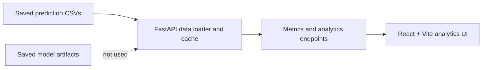

# Crypto Forecasting · Model Intelligence

FastAPI and React analytics for the saved prediction CSVs in this repository. The existing Streamlit app remains at `app.py`. No training or live prediction runs in this application.

## Data inventory

| Model | CSV | Availability | Normalized dates |
|---|---|---|---|
| LSTM | `LSTM_Light_GBM/results/lstm_predictions.csv` | 452 rows; `Date,Actual_Close,LSTM_Prediction` | 2021-01-08 to 2022-10-16 |
| LightGBM | `LSTM_Light_GBM/results/lightgbm_predictions.csv` | 452 rows; `Date,Actual_Close,LightGBM_Prediction` | 2021-01-08 to 2022-10-16 |
| Prophet | `Prophet_HistGradientBoosting/outputs/prophet_final_results.csv` | 603 rows; `ds,y,predicted,error` | 2020-08-05 to 2022-10-16 |
| HistGradientBoosting | `Prophet_HistGradientBoosting/outputs/histgradientboosting_final_results.csv` | 603 rows; `Date,Target,Predicted,Error` | 2020-08-05 to 2022-10-16 |
| TFT | `TFT_NBEATS/results/tft/final_tft_predictions.csv` | 452 rows; `Date,Actual_Close,Predicted_Close,Absolute_Error,Percentage_Error` | 2021-01-08 to 2022-10-16 |
| N-BEATS | `TFT_NBEATS/results/nbeats/final_nbeats_predictions.csv` | 452 rows; `Date,Actual,Predicted,Error` | 2021-01-08 to 2022-10-16 |

Saved artifacts discovered: Prophet and HistGradientBoosting `.pkl`, TFT `.ckpt`, and N-BEATS `.pt`. They are intentionally unused. No LSTM or LightGBM model artifacts were found. The two saved prediction CSVs are now present and loaded.

On the four loaded files, 452 dates overlap. Their saved `Actual` values differ by more than $0.01 on all 452 shared dates. Like-for-like metrics therefore use the mean actual value across the selected files for each shared date, and the API/UI flag the discrepancy; inspect Data & Coverage before interpreting model scores.

## Run locally

Backend (Python 3.10+):

```sh
python -m pip install -r backend/requirements.txt
uvicorn backend.main:app --reload
```

Frontend (Node 18+):

```sh
npm install
npm run dev
```

The UI is at `http://localhost:5173`; Vite proxies `/api` to port 8000. `run.sh` starts both processes on Unix-like systems. On Windows, open two terminals and run the backend and frontend commands separately.

## Architecture



## Screenshots

Placeholder: add product screenshots after running the UI.

## API

`GET /api/health`, `POST /api/reload`, `GET /api/models`, `/api/overview`, `/api/predictions`, `/api/predictions/{date}`, `/api/predictions/{date}/neighbors`, `/api/metrics`, `/api/best`, `/api/rankings/history`, `/api/winrate`, `/api/residuals`, `/api/rolling`, `/api/calendar`, `/api/breakdown`, `/api/scatter`, `/api/ensemble`, `/api/backtest`, `/api/export/metrics.csv`, `/api/export/predictions.csv`, and `/api/export/date/{date}.csv`.

The default recommendation scores common dates using min-max normalized MAE, RMSE, MAPE, and directional accuracy with weights 0.35/0.25/0.20/0.20. Ensemble and backtest outputs are derived from saved predictions and are educational only.
